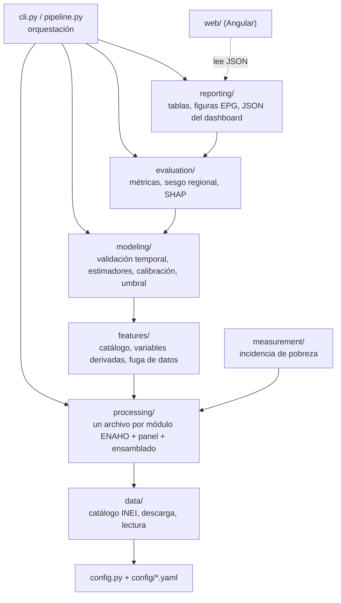

# Arquitectura del proyecto

El proyecto está dividido en capas. Cada capa solo usa a las que están debajo de ella,
y cada archivo hace una sola cosa. Ningún archivo de código supera las 250 líneas.

## Flujo de datos

| Etapa | Comando | Entrada | Salida |
| --- | --- | --- | --- |
| 1. Descarga | `pobreza descargar` | Portal de microdatos del INEI | `datos/crudos/<año>/<módulo>.zip` |
| 2. Construcción | `pobreza construir` | Zips | `datos/procesados/hogares.parquet` (una fila por hogar-año) |
| 3. Medición | `pobreza medir` | Base de hogares | Incidencia anual de pobreza (personas y hogares) validada contra el INEI |
| 4. Entrenamiento | `pobreza entrenar` | Base de hogares | Modelos por pliegue y modelo final calibrado |
| 5. Evaluación | `pobreza evaluar` | Modelos | Métricas, sesgo regional, SHAP, prueba con y sin hogares repetidos |
| 6. Reportes | `pobreza reportar` | Resultados | Tablas y figuras para la tesis, JSON para la web |

`pobreza todo` corre las seis etapas en orden. Cada etapa guarda su salida en disco,
así que se puede repetir una sin volver a correr las anteriores.

## Capas

| Carpeta | Responsabilidad | Archivos |
| --- | --- | --- |
| `config/` | Parámetros sin código: años, rutas, códigos INEI, hiperparámetros, catálogo de variables | `pipeline.yaml`, `model.yaml`, `features.yaml` |
| `src/pobreza/data/` | Saber dónde está cada archivo del INEI, descargarlo y leerlo | `catalog.py`, `download.py`, `readers.py` |
| `src/pobreza/processing/` | Convertir cada módulo de la ENAHO en una tabla con una fila por hogar | `keys.py`, `sumaria.py`, `vivienda.py`, `miembros.py`, `educacion.py`, `salud.py`, `empleo.py`, `programas.py`, `panel.py`, `assemble.py` |
| `src/pobreza/measurement/` | Calcular la incidencia de pobreza como el INEI | `poverty.py` |
| `src/pobreza/features/` | Documentar, derivar y proteger las variables predictoras | `catalog.py`, `derived.py`, `leakage.py`, `collinearity.py` |
| `src/pobreza/modeling/` | Partir por años, entrenar, calibrar y elegir el umbral | `splits.py`, `estimators.py`, `calibration.py`, `thresholds.py`, `training.py` |
| `src/pobreza/evaluation/` | Medir el desempeño y explicar el modelo | `metrics.py`, `regional.py`, `explain.py` |
| `src/pobreza/reporting/` | Producir lo que va a la tesis y al dashboard | `style.py`, `figures_datos.py`, `figures_modelo.py`, `tables.py`, `docx_tables.py`, `dashboard_export.py` |
| `tests/` | Pruebas con datos sintéticos que imitan la estructura de la ENAHO | `synthetic.py` y un archivo por capa |
| `web/` | Web de resultados (Angular 19, gráficos SVG propios con d3) | Ver `web/README.md` |

## Decisiones de diseño

- **La variable objetivo se valida antes de modelar.** La etapa de medición reproduce la
  incidencia oficial del INEI (FACTOR07 × MIEPERHO). Si no coincide dentro de la tolerancia,
  el pipeline se detiene: un modelo entrenado con un objetivo mal construido no sirve.
- **Los identificadores del hogar se conservan.** CONGLOME, VIVIENDA y HOGAR viajan con
  cada fila, y la variable PANEL del módulo 100 marca a los hogares entrevistados el año anterior.
- **El umbral se elige en el año de calibración**, nunca en el de prueba.
- **Las variables están en un catálogo (`features.yaml`)** con su módulo, definición, teoría y
  signo esperado. Del catálogo salen la tabla de variables de la tesis y la tabla puente
  teoría → variable.
- **Las figuras no llevan título dentro de la imagen.** El rótulo y el título los pone la tesis
  (formato EPG). Las etiquetas están en español.
- **Configuración fuera del código.** Cambiar años, hiperparámetros o variables no requiere
  editar Python.
